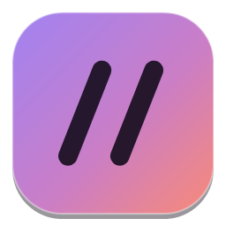
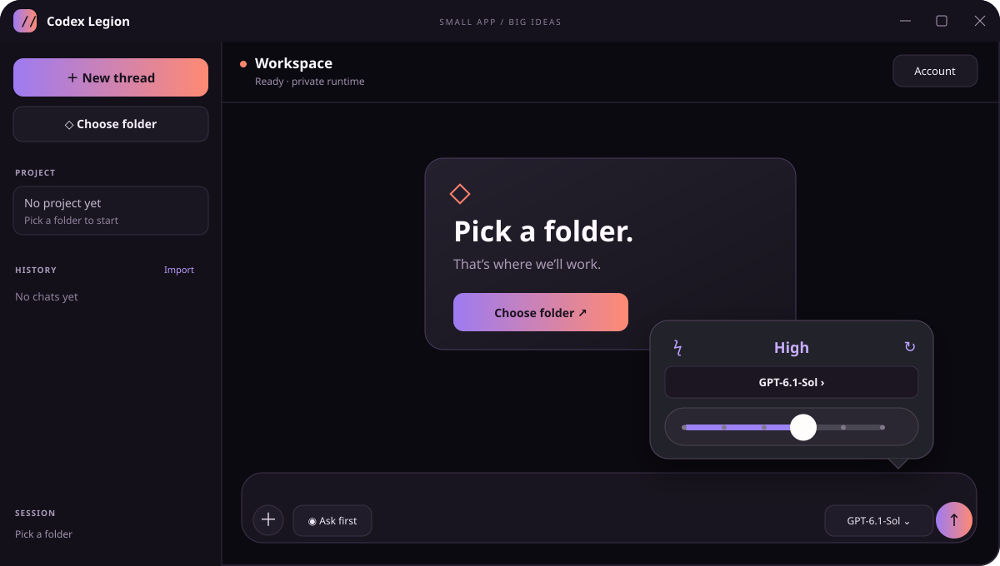

<p align="center">
  
</p>

<h1 align="center">Codex Legion</h1>

<p align="center">
  A small native Windows home for Codex.<br>
  Private profile, real project tools, less desktop overhead.
</p>



## Why this exists

Codex is excellent at the actual work: understanding a repository, changing files, running commands, reviewing diffs, and staying with a task until it is finished. The official desktop experience is polished, but it also carries the weight of a browser-based application.

Codex Legion started with a simple question: **how much of that experience can live inside a genuinely native Windows shell?**

The result is a WPF client that feels at home on Windows and leaves the agent work to a private Codex app-server process. There is no Chromium window, Node.js runtime, WebView, or local TCP service in the interface. The client and server talk directly over JSONL through standard input/output.

It is useful when you want:

- a lighter Codex window beside an editor or game engine;
- a clean project-first workspace without an automatically selected folder;
- a separate login and chat history from the official app;
- clear control over model, thinking effort, approvals, and file access;
- an install that works even when the official Codex app is not present.

## What it can do

Codex Legion covers the everyday coding loop: persistent chats, streaming replies, model selection, a snap-to-level thinking slider, approval modes, commands, file changes, plans, reasoning summaries, web searches, token usage, and native diff cards.

You can stop or steer an active turn, attach images, use local skills, inspect Git status, create managed worktrees, and reopen or organize previous chats. Approval, permission, question, and MCP prompts stay inside the same themed interface instead of falling back to generic Windows dialogs.

Official Codex history is never pulled in silently. After the first login and PIN setup, the app asks whether you want to copy it. You can say no and keep a completely clean slate, or import it later from the sidebar.

## Pick your installer

| Download | Best for | Size |
| --- | --- | ---: |
| **CodexLegionSetup.exe** | Normal installation. Downloads the verified private runtime when needed. | ~0.6 MB |
| **CodexLegionSetup-offline.exe** | A complete install for offline or repeat setups. | ~164 MB |

Both are per-user installers and do not need administrator access. Codex Legion installs under `%LOCALAPPDATA%\Programs\Codex Legion`, can add Start menu or desktop shortcuts, and includes an uninstaller.

The raw application EXE is intentionally not published as a release download. Pick one of the two installers from the [latest release](../../releases/latest).

## Your account stays separate

Codex Legion does not borrow the official app's saved credentials. It gives its app-server a dedicated profile, removes ambient OpenAI credential variables from the child process, and protects remembered authentication with Windows DPAPI while the server is stopped.

After signing in once, you set a 4–12 digit PIN. The login is remembered, while the PIN is requested again every seven days—useful on a computer that other people may occasionally touch without making you sign in every launch.

The PIN is a friendly local gate, not a replacement for a separate Windows account. Someone with full access to your Windows profile can also modify local applications.

## What it is built on

```text
Codex Legion — native WPF / .NET Framework UI
    │
    └── JSON-RPC over stdin/stdout
          │
          └── private OpenAI Codex app-server
                ├── isolated login and chat history
                ├── model and approval capabilities
                ├── agent loop and streamed events
                └── sandboxed local tools
```

The UI keeps only lightweight rendered state. The Codex runtime lives in a separate child process, so its memory is visible independently and is released when the app closes. No server port is opened.

Codex itself is the open-source [OpenAI Codex runtime](https://github.com/openai/codex). Codex Legion is an independent community client and is not an official OpenAI application.

## Updates without surprises

**Tools → Check for updates** reads the latest public GitHub release. If a newer version exists, Codex Legion downloads the small installer, verifies its SHA-256 digest, and asks before launching it.

The web installer fetches a runtime only when it is missing or its pinned fingerprint changed. The larger offline installer already carries the same verified runtime.

## Building it yourself

Windows already includes most of what the project needs:

```powershell
./build.ps1
./run.ps1
./test.ps1
```

To create the installers, point the packager at a Codex Windows runtime directory:

```powershell
./package.ps1 -RuntimeSource C:\path\to\codex-runtime -Version 0.3.0 -Zip
```

The source intentionally stays simple: code-only WPF, the inbox .NET Framework compiler, PowerShell packaging, and no JavaScript dependency tree.

## Still growing

The core coding workflow is here, but rich Markdown, voice mode, full connector installation, and multi-window work are still future territory. If something feels rough, an issue with a screenshot and a short explanation is the most useful kind of report.
